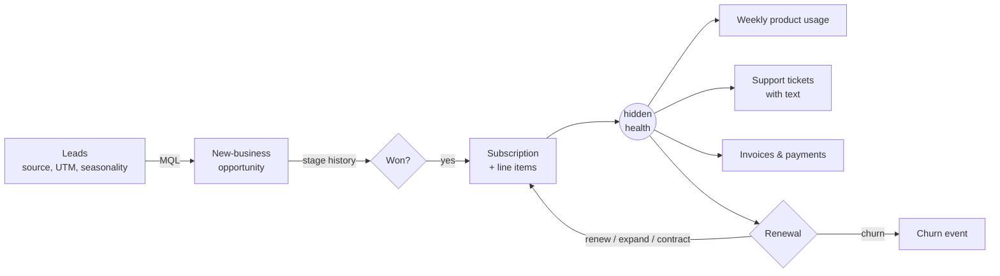

# Ledgerly Data

**A realistic synthetic B2B SaaS company, with CRM, billing, product usage and support data, plus hidden ground truth for testing analytics and AI work against.**

Public datasets rarely look like what a RevOps, analytics or CS team actually works with. Real company data can't be shared. So I simulated a company end to end: **Ledgerly**, a fictional seat-based finance-operations platform, from its first marketing lead in January 2023 to a snapshot on **September 30, 2026**.

The data comes out the way it would from Salesforce, a billing system, product analytics and a support desk, messiness included. The underlying "truth" (customer health, real duplicates, real ticket categories, how open deals actually end) is exported separately, so models and data-quality tools can be scored rather than just demoed.

This repo is the foundation for my portfolio projects (revenue metrics, forecasting, dedupe, churn, AI ticket triage, and more). See [Projects that use it](#projects-that-use-it).

## Quickstart

```bash
python -m venv .venv && source .venv/bin/activate
pip install -e ".[dev]"
ledgerly-generate --seed 42 --out data    # ~10 seconds
pytest                                    # 25 invariant + realism tests
```

Outputs:
- `data/raw/*.csv`: the "exports"
- `data/truth/*.csv`: ground truth
- `data/parquet/`: Parquet copies
- `data/ledgerly.duckdb`: a DuckDB database with `raw` and `truth` schemas

Query it right away:

```bash
duckdb data/ledgerly.duckdb "select segment, count(*) from raw.accounts where status='Customer' group by 1"
```

## The company (seed 42)

| Metric | Value |
|---|---|
| ARR at snapshot | **$39.8M**, up from $12.7M two years earlier |
| Customers | 709 active: 457 SMB, 208 Mid-Market, 44 Enterprise |
| Net revenue retention (trailing 12 mo.) | **105%** (Enterprise 111%, SMB 84%) |
| Gross revenue retention (trailing 12 mo.) | 85% |
| Median new-business ACV | $7K SMB · $55K Mid-Market · $330K Enterprise |
| New-business win rate | 36% SMB → 24% Enterprise; referrals ~55%, paid social ~20% |
| Sales cycle (median) | 20 / 51 / 98 days |
| Open pipeline at snapshot | ~290 opportunities with weighted forecast categories |

Every assumption (prices, segment mix, win rates, churn, seasonality, lead sources) lives in [`config.py`](src/ledgerly/config.py), so the business is easy to read and change.

## How it's simulated



- Each account gets a hidden **fit** score at creation. Fit drives win probability, and after the sale it sets the level that **health** reverts to each month. Health also takes random shocks: a champion leaves, a rollout goes badly.
- **Health drives everything a CSM would see:** seat adoption, feature usage, ticket volume and mix (more bugs and cancellation requests when unhealthy), CSAT, late payments, expansion, contraction and churn.
- **Contracts are modeled as subscription lines** (new, mid-term expansion co-termed to the renewal date, renewal with price uplift), so ARR, NRR and cohort metrics have to be derived properly. They aren't precomputed.
- **Opportunities carry full stage history.** Deals still open at the snapshot keep their hidden true outcome, for forecast back-testing.
- **The sales team has territories and roughly 18% annual attrition with backfills,** so ownership changes over time.

## Schema

**`raw` schema: what the systems export**

| Table | Grain | Notes |
|---|---|---|
| `leads` | lead | source, UTM campaign, MQL/conversion timestamps |
| `accounts` | account | firmographics, owner/CSM, status; **includes duplicates** |
| `contacts` | contact | **includes duplicates, bad emails, mixed phone formats** |
| `opportunities` | opportunity | New Business / Expansion / Renewal; **stale close dates** on some open deals |
| `opportunity_stage_history` | stage change | for velocity and conversion analysis |
| `subscriptions`, `subscription_lines` | contract / contract line | MRR by line; the source of truth for ARR |
| `invoices` | invoice | annual vs. monthly billing; paid / overdue / written off |
| `product_usage_weekly` | account × week | seats, weekly active users, feature counts, integrations |
| `support_tickets` | case | **free-text subject and description**, agent-entered category (noisy) |
| `users` | employee | AEs, CSMs, SDRs with hire and termination dates |

**`truth` schema: never visible to "the business"**

| Table | Use it to |
|---|---|
| `account_duplicates`, `contact_duplicates` | score dedupe / identity-resolution precision and recall |
| `ticket_labels` | evaluate AI ticket classification, priority and routing |
| `account_health_monthly`, `account_fit`, `churn_events` | back-test health scores and churn models |
| `open_opportunity_outcomes` | back-test pipeline forecasts |

Full column definitions are in [`docs/data_dictionary.md`](docs/data_dictionary.md).

## Data-quality issues (intentional)

| Issue | Rate | Recorded in truth? |
|---|---|---|
| Duplicate accounts (name variants, typos, "The …", URL formats) | ~4.5% | ✅ |
| Contacts attached to the duplicate instead of the master account | ~35% of a dupe's contacts | via `account_duplicates` |
| Duplicate contacts (nicknames, upper-case or personal emails, typos) | ~6% | ✅ |
| Invalid emails, missing titles, inconsistent phone formats | 1.5% / 7% / 30% | — |
| State stored as "MD", "md" or "Maryland" | ~8% | — |
| Open deals with a close date already in the past | ~12% of open pipeline | — |
| Missing amount on early-stage deals | ~30% of Discovery | — |
| Support agent category wrong or blank | ~22% | ✅ `ticket_labels` |

## Projects that use it

| Project | What it proves |
|---|---|
| SaaS revenue metrics warehouse (dbt) | ARR/NRR/churn modeling, metric definitions, data tests |
| CRM dedupe & identity-resolution toolkit | matching, survivorship, data quality reporting |
| Pipeline & forecast cockpit | conversion, velocity, forecast accuracy back-test |
| Customer health score & churn early warning | scoring and back-testing against real churn |
| AI support-ticket triage agent with evals | LLM classification and routing, scored on `ticket_labels` |
| AI weekly business review | LLM narrative with every number checked against the warehouse |

(Links added as each project ships.)

## Notes

- **Deterministic:** the same `--seed` gives identical data (there's a test for this).
- All people, companies and emails are fake (Faker). Any resemblance to real companies is coincidental.
- MIT licensed.
